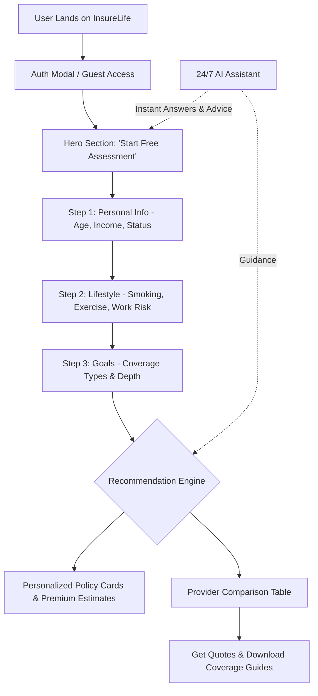

# 🛡️ InsureLife – Smart Insurance Recommendation & Advisory Platform

[](https://developer.mozilla.org/en-US/docs/Web/HTML)
[](https://developer.mozilla.org/en-US/docs/Web/CSS)
[](https://developer.mozilla.org/en-US/docs/Web/JavaScript)
[](https://opensource.org/licenses/MIT)
[](http://makeapullrequest.com)

> **InsureLife** is an intelligent, user-centric insurance advisory web application. It guides individuals through an intuitive 3-step lifestyle risk assessment, generates dynamic personalized insurance recommendations, and enables real-time provider comparisons with an embedded 24/7 AI chatbot assistant.

---

## 📑 Table of Contents

- [Overview](#-overview)
- [Key Features](#-key-features)
- [How It Works](#-how-it-works)
- [Tech Stack](#-tech-stack)
- [Project Structure](#-project-structure)
- [Getting Started](#-getting-started)
- [Application Walkthrough](#-application-walkthrough)
- [Comparison Engine](#-comparison-engine)
- [Roadmap & Enhancements](#-roadmap--enhancements)
- [Contributing](#-contributing)
- [License](#-license)

---

## 🌟 Overview

Navigating insurance policies, premiums, and coverage tiers is often complicated and overwhelming. **InsureLife** transforms this process into a frictionless, transparent experience:
- **Zero Paperwork:** Complete a fast 5-minute lifestyle profile.
- **Data-Driven Match:** Coverage and premiums are custom-calculated based on user age, income bracket, lifestyle choices (e.g. smoking habits, workout frequency), and occupational risk.
- **Provider Transparency:** Benchmark recommended plans directly against top industry providers (State Farm, Allstate, Progressive, Geico, and Blue Cross Blue Shield).

---

## ✨ Key Features

### 📋 1. Multi-Step Lifestyle Assessment
- **Step 1: Personal Info** – Captures age, annual income bracket, and marital status.
- **Step 2: Lifestyle & Health** – Analyzes lifestyle risk factors (smoking habits, exercise frequency, and occupation risk tier).
- **Step 3: Financial Goals & Coverage** – Selects insurance categories (Life, Health, Disability, Property) and coverage tier (Basic, Standard, Comprehensive).
- **Dynamic Progress Bar** – Real-time visual tracking of assessment completion.
- **Live Form Validation** – Instant feedback and error handling to guarantee clean inputs.

### 💡 2. Dynamic Recommendation Engine
- **Algorithmic Pricing & Sizing:** Computes estimated life coverage, monthly premiums, health deductibles, and dwelling protection tailored to user metrics.
- **Tier Breakdown:** Clear display of benefits, deductibles, out-of-pocket maximums, and policy features.
- **Actionable Steps:** Direct options to request instant quotes, review policy details, or contact an advisor.

### 📊 3. Provider Comparison Matrix
- **Interactive Multi-Filter Table:** Compare policies by insurance type (Life, Health, Auto, Property) or filter by provider.
- **Benchmark Analytics:** Automated calculation highlighting:
  - 🏆 **Best Value Provider**
  - 💰 **Lowest Premium Option**
  - ⭐ **Highest Customer Rated Provider**

### 🤖 4. 24/7 AI Insurance Chatbot
- Floating, distraction-free conversational assistant widget.
- Pre-configured quick-prompt suggestions (*"Types of Insurance"*, *"Coverage Calculator"*, *"Life Insurance Benefits"*, *"Save on Premiums"*).
- Responsive conversational replies for policy FAQs, inquiries, and advisor handoffs.

### 🔐 5. Modern Authentication UI
- Tabbed Sign In / Sign Up modal dialog.
- Responsive overlay with smooth fade-in animations and modal management.
- Form validation and session-ready design.

### 🎨 6. Premium Responsive Aesthetics
- **Glassmorphic Gradients & Smooth Shadows** for a sleek, trustworthy financial platform feel.
- **Typography:** Crisp typography powered by Google Fonts (Inter).
- **Iconography:** Rich iconography via Font Awesome 6.
- **100% Responsive:** Optimized for desktops, laptops, tablets, and smartphones.

---

## 🧠 How It Works



---

## 🛠️ Tech Stack

| Technology | Purpose |
| :--- | :--- |
| **HTML5** | Semantic structure, accessible forms, meta optimization |
| **CSS3** | Glassmorphism, CSS Grid, Flexbox, custom variables, smooth transitions |
| **JavaScript (ES6+)** | Multi-step form management, dynamic calculation logic, chatbot engine, modal controller |
| **Google Fonts** | Modern Inter typeface for clear readability |
| **Font Awesome 6** | Modern UI and status vector iconography |

> **Zero Dependencies:** Pure Vanilla HTML/CSS/JS without heavyweight frameworks or build tools required to run.

---

## 📂 Project Structure

```bash
InsureLife/
├── index.html       # Primary application markup (Hero, Assessment, Results, Comparison, Chatbot)
├── styles.css       # Complete design system, layouts, components, dark/light accents & animations
├── script.js        # Core logic: form stepper, scoring algorithms, chatbot, comparison filters
└── README.md        # Comprehensive project documentation
```

---

## 🚀 Getting Started

No `npm install` or compilation step is required! You can run InsureLife immediately using any of the following methods:

### Method 1: Direct File Launch
Double-click `index.html` or right-click and open with your browser of choice (Chrome, Edge, Firefox, Safari).

### Method 2: VS Code Live Server (Recommended)
1. Open the project folder in **Visual Studio Code**.
2. Install the **Live Server** extension (`ritwickdey.LiveServer`).
3. Right-click `index.html` and select **"Open with Live Server"**.
4. The site will automatically launch at `http://127.0.0.1:5500`.

### Method 3: Python Built-in Server
Run either command in your terminal from the root folder:
```bash
# Python 3.x
python -m http.server 8000
```
Then visit [http://localhost:8000](http://localhost:8000).

### Method 4: Node.js `serve`
```bash
npx serve .
```

---

## 🖥️ Application Walkthrough

### 1. Landing & Hero
- Trust badge showing 50,000+ satisfied customers.
- Quick navigation to assessment, features, and about sections.
- Quick stats: *5-minute assessment, 3 simple steps, 100% free*.

### 2. Guided Assessment Flow
- Form steps are saved progressively in client state.
- Interactive controls including radio toggles, styled select dropdowns, and multi-select checkboxes.

### 3. Dynamic Calculation Logic
The application evaluates user inputs through specialized calculation routines:
- **Life Insurance Coverage:** Multiplier applied to income tier and scaled inversely with age brackets.
- **Premium Adjustments:** Base rates weighted by smoking status, health activities, and occupational danger levels.
- **Health & Property Protection:** Calculates deductibles, max out-of-pocket, and dwelling coverage recommendations.

### 4. Interactive Comparison Table
- Filter rows dynamically by insurance product (Life, Health, Auto, Property).
- Search and filter by specific carrier (State Farm, Geico, Allstate, Progressive, BCBS).
- Interactive buttons to initiate quote requests.

---

## 🤖 24/7 AI Chatbot Assistant

The bottom-right widget acts as a virtual concierge:
- Toggle open/close with responsive slide animation.
- Instant chips for frequent inquiries:
  - ❓ *Types of Insurance*
  - 🧮 *Coverage Calculator*
  - 🛡️ *Life Insurance Benefits*
  - 💵 *Ways to Save on Premiums*
- Handles custom text queries and guides users through plan selection.

---

## 🗺️ Roadmap & Enhancements

- [ ] **Backend Integration:** Node.js / Express or Python FastAPI service for persisting user profiles.
- [ ] **Database Integration:** PostgreSQL / Supabase for storing policy quotes and user histories.
- [ ] **Generative AI API:** Connect chatbot directly to Gemini or OpenAI API for real-time natural language answers.
- [ ] **PDF Export:** Generate downloadable personalized policy summary reports via jsPDF.
- [ ] **Payment & Policy Binding:** Integration with Stripe or carrier APIs for digital plan binding.

---

## 🤝 Contributing

Contributions are welcomed! Follow these steps:

1. **Fork the repository**
2. **Create your feature branch:**
   ```bash
   git checkout -b feature/AmazingFeature
   ```
3. **Commit your changes:**
   ```bash
   git commit -m "Add some AmazingFeature"
   ```
4. **Push to the branch:**
   ```bash
   git push origin feature/AmazingFeature
   ```
5. **Open a Pull Request**

---

## 📄 License

This project is licensed under the **MIT License** — feel free to use, modify, and distribute for personal or commercial projects.

---

<p align="center">
  Made with ❤️ for smart, transparent, and accessible insurance planning.
</p>
